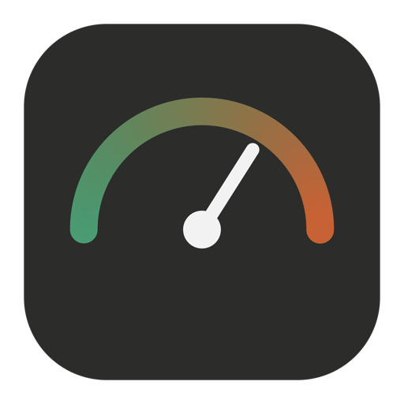

# Token Tracker for macOS

<br clear="left">

Claude Code, Codex, Gemini CLI·Antigravity의 토큰 사용량과 남은 한도를 **메뉴바**에서 보고,
**대시보드**로 자세히 보는 macOS 앱입니다. 모든 기록은 내 Mac 안에만 저장되고 대화 내용은
읽지 않으며 토큰 수만 셉니다. Python 표준 라이브러리만 사용합니다(pip 설치 없음).

[hihikkul/token-tracker](https://github.com/hihikkul/token-tracker)(Windows용, MIT)를 바탕으로
macOS 앱화와 기능을 더한 파생작입니다.

## 추가된 기능 (원본 대비)

- macOS 메뉴바 앱(`TokenTracker.app`, .dmg 배포) — 한도 %를 메뉴바에 표시, 내장 대시보드 창
- macOS 경로·키체인 인증, LaunchAgent 자동 시작
- Gemini CLI + Antigravity 사용량 집계(SQLite 직접 파싱)
- 쌀먹 비율(롤링 30일 API 환산 비용 ÷ 구독료)
- 프로젝트·세션별 캐시 적중률

## 설치

릴리스의 `TokenTracker.dmg`를 열어 앱을 `/Applications`로 옮깁니다. 서명은 ad-hoc이라 처음에는
우클릭 → 열기가 필요할 수 있습니다. 시스템의 `/usr/bin/python3`(Command Line Tools)를 씁니다.
직접 빌드:

```sh
./macapp/build.sh && open dist/TokenTracker.app
```

앱은 Dock 아이콘 없이 메뉴바에 도구별 최고 사용률을 60초마다 갱신해 표시합니다. 메뉴에서 한도·리셋
시간 확인, 대시보드 열기, 새로고침, 로그인 시 자동 실행, 종료를 할 수 있습니다. 이미 8765 포트에
백엔드가 있으면 재사용하고, 없으면 번들의 `app.py`를 실행하며 종료 시 자신이 띄운 것만 끕니다.

## 명령줄로 실행

```sh
./run.sh                 # 위젯(tkinter 있을 때) 또는 대시보드
./run.sh --dashboard --no-browser
./run.sh --scan          # 로그 한 번 집계
./ratio.sh               # 쌀먹 비율 표
./doctor.sh              # 로그 경로·건수·인증 진단
```

대시보드: http://127.0.0.1:8765/ (내 Mac에서만 열림). 포트가 사용 중이면 다음 9개를 시도합니다.

## 데이터와 인증

기본 데이터 폴더는 `~/Library/Application Support/TokenTracker`입니다.
`usage.db`, `config.json`을 저장하며 `TOKENTRACKER_HOME`으로 바꿀 수 있습니다.
Windows/Linux 경로는 해당 OS에서만 사용합니다.

| 도구 | 로컬 사용량 | 한도 |
|---|---|---|
| Claude Code | `~/.claude/projects/**/*.jsonl` | Anthropic OAuth usage 엔드포인트 |
| Codex(GPT) | `~/.codex/sessions/**/*.jsonl`, `archived_sessions/**/*.jsonl` | 로그의 `rate_limits` |
| Gemini CLI | `~/.gemini/tmp/*/chats/*.json` | 조회 경로 없음, 사용량만 표시 |
| Antigravity | `~/.gemini/antigravity*/conversations/*.db` (SQLite) | 조회 경로 없음, 사용량만 표시 |

Claude 인증은 macOS에서 `security find-generic-password -s "Claude Code-credentials" -w`
명령의 결과를 **프로그램 내부에서만** 읽습니다. 실패하거나 유효한 OAuth 토큰이 없으면
`~/.claude/.credentials.json`로 폴백합니다. `CLAUDE_CONFIG_DIR`과 추가 경로의 인증 파일도
지원합니다. 키체인 접근 승인이 필요할 수 있습니다. 토큰은 출력·로그·DB에 저장하지 않고,
갱신하거나 로그인 정보를 변경하지 않습니다. 위 명령을 터미널에서 직접 실행하면 토큰이
보이므로 진단에는 `./doctor.sh`를 사용하세요.

- Claude 한도는 기본 5분마다 `https://api.anthropic.com/api/oauth/usage`에 조회합니다.
  비공식 엔드포인트라 실패할 수 있으며 로그 집계는 계속됩니다.
- Codex/Gemini 사용량 조회에는 네트워크를 사용하지 않습니다.
- JSON/JSONL 로그를 읽되 대화 본문·코드는 DB에 저장하지 않습니다. 저장하는 것은
  토큰 수, 시간, 모델, 프로젝트·세션 식별자입니다. Codex 로컬 DB에서 읽은 대화 제목은
  대시보드 데이터에 포함될 수 있습니다. 내보낸 JSON과 로컬 API도 민감하게 취급하세요.
- HTTP 서버는 `127.0.0.1`에만 바인딩합니다. D3는 저장소의 로컬 파일을 쓰며 CDN/분석
  서비스로 전송하지 않습니다. Anthropic 한도 요청 외 자동 외부 전송은 없습니다.
  `artifact_url`을 설정하고 직접 열면 그 외부 사이트에 접속할 수 있습니다.
- 비용은 `prices.json`의 **API 정가 환산 추정치**이지 구독 청구액이 아닙니다.
  가격표는 오래되거나 비공식인 값이 있으므로 필요한 모델 단가를 확인해 수정하세요.

## 위젯과 대시보드

위젯은 Claude/Codex의 5시간·주간 잔여 한도를 표시합니다. Gemini는 **오늘의 로컬 토큰 수**만
표시합니다. 위젯 제목을 드래그해 이동하고 우클릭/Control-click으로 메뉴를 엽니다.
macOS 글꼴 기본값은 Helvetica이며 없는 글꼴은 Tk 기본 글꼴로 폴백합니다.

대시보드는 기간, Claude/Codex/**Gemini**, 토큰/비용 필터와 모델·프로젝트 필터를 지원합니다.
총 토큰, 비용 추정치, 캐시, 일별·시간대·월별 사용량, **프로젝트·세션별 캐시 적중률**을 확인할 수 있습니다.

주요 로컬 API:
- `GET /api/data`: 대시보드 데이터, `meta.by_source`의 도구별 전체 건수·토큰
- `GET /api/stats?days=30`: `by_source`의 선택 기간 건수·토큰,
  `all_time_by_source`의 전체 건수·토큰 (기록이 없어도 세 도구 모두 포함)
- `GET /api/doctor`: 스캔 경로·파일 수와 도구별 전체 건수·토큰

## 설정

`~/Library/Application Support/TokenTracker/config.json`은 첫 실행 시 생성됩니다.

- `widget.show`: 기본 `["claude", "codex", "gemini"]`; 기존 설정을 유지하므로
  Gemini가 없다면 목록에 `"gemini"`를 추가하세요.
- `widget.font`, `widget.number_font`, `widget.opacity`, `widget.topmost`
- `port`: 8765, `scan_interval_sec`: 60, `limits_interval_sec`: 300
- `extra_paths`: 기본 위치 밖 로그 추가, 예: `"claude": ["/Volumes/backup/.claude/projects"]`
- `CLAUDE_CONFIG_DIR`, `CODEX_HOME`, `GEMINI_HOME`, `TOKENTRACKER_HOME`: 경로 환경변수
- `./run.sh --export /원하는/폴더`: 집계 JSON을 파일로 내보내기 (업로드하지 않음)

## 쌀먹 비율 (롤링 30일)

`./ratio.sh` 또는 `python3 app.py --ratio`로 도구별·합계 표를 확인합니다.
대시보드 상단 카드와 `/api/stats`의 `ratio`에도 동일하게 포함됩니다.

- 배율 = 최근 **30 × 24시간** API 환산 비용 ÷ 월 구독료. 이번 달 시작일,
  가입 기간이나 대시보드 기간·도구 필터와 무관하며 부족한 기간을 월간으로 확대하지 않습니다.
- 절약액 = API 환산 비용 − 월 구독료 (음수 가능). 실제 절약액/청구액이 아닌 추정 비교입니다.
- `config.json`의 `"subscriptions": {"claude": 20, "codex": 20, "gemini": 5}`를
  사용합니다(USD/월). 기본값도 이 값이며 **본인 요금제로 고치세요**.
- 명시된 subscriptions 목록에 도구가 없거나 값이 0이면 `구독료 미설정`으로 표시합니다.
  미설정 도구가 하나라도 있으면 합계 배율·절약액도 표시하지 않습니다.
- API의 `ratio.by_source`/`ratio.total` 필드: `api_cost_usd`, `subscription_usd`,
  `ratio`, `savings_usd`, `status`; 미설정 배율과 절약액은 `null`입니다.
  가격표 없는 모델은 기존 비용 집계처럼 비용에서 제외됩니다.

## 로그인 자동 시작 (선택)

**등록/해제는 사용자가 직접 실행할 때만 시스템 설정을 변경합니다.**

```sh
./install_startup.sh
# 해제
./uninstall_startup.sh
```

등록 스크립트는 변경 내용을 먼저 출력하고
`~/Library/LaunchAgents/com.tokentracker.plist`를 만든 뒤 `launchctl bootstrap`합니다.
로그인 시 자동 시작하며 등록 직후에도 실행됩니다. `--dashboard --no-browser`로
위젯 없이 백그라운드에서 실행하며 브라우저도 자동으로 열지 않습니다.
실행 시의 Python 절대 경로와 데이터/로그 경로 환경변수를 plist에 저장하므로 launchd의
제한된 PATH에 의존하지 않습니다. 프로젝트나 Python 위치를 옮겼으면 다시 등록하세요.
실행 로그는 `~/Library/Logs/TokenTracker/startup.log`, `startup-error.log`에 남습니다.
해제는 launchd 작업을 종료하고 plist만 삭제하며 사용량 DB는 보존합니다.

## 문제 해결

`./doctor.sh`에서 도구별 폴더·파일·전체 건수·토큰을 확인하세요.
Claude 토큰이 만료되었으면 Claude Code를 직접 실행해 갱신하세요.
Python 인증서 오류(`CERTIFICATE_VERIFY_FAILED`)로 한도 조회가 실패하면 한도만 offline으로
표시되고 집계는 계속됩니다. TLS 검증을 끄지 않으니 Python의 인증서 설정을 확인하세요.
로그가 없는 도구는 0건으로 표시되며 해당 CLI를 사용한 뒤 다시 집계할 수 있습니다.
서버는 로컬 사용자 인증을 제공하지 않으므로 신뢰할 수 없는 로컬 프로그램/사용자와
컴퓨터를 공유할 때는 켜 두지 마세요. 자동 시작이 필요 없으면 등록하지 않아도 됩니다.

## 라이선스

MIT (원 저작자 hihikkul, macOS 확장 DH-WEST-coder). 포함된 D3는 ISC 라이선스입니다.

## Current Work

- **NOW**: 공개 저장소 첫 릴리스 준비 완료 (메뉴바 앱, 캐시 적중률, Antigravity 집계).
- **NEXT**: GitHub Release에 dmg 첨부, 유니버설(x86_64) 빌드 확인, 앱 스크린샷 추가.
- **DONE**: macOS 이식, 메뉴바 앱·dmg 빌드, Gemini/Antigravity 집계, 쌀먹 비율, 작업별 캐시 적중률.
